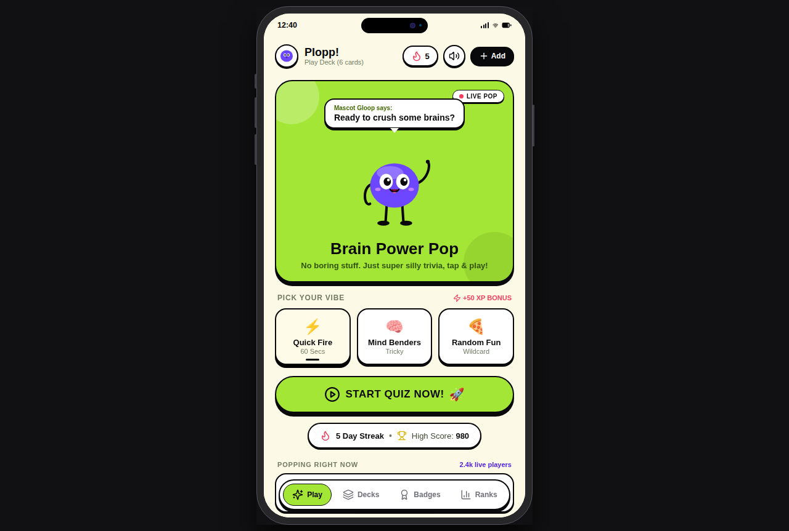
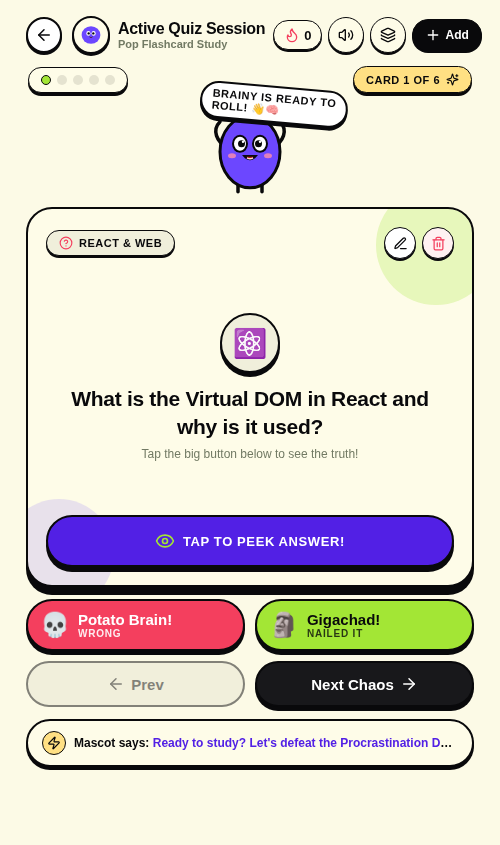
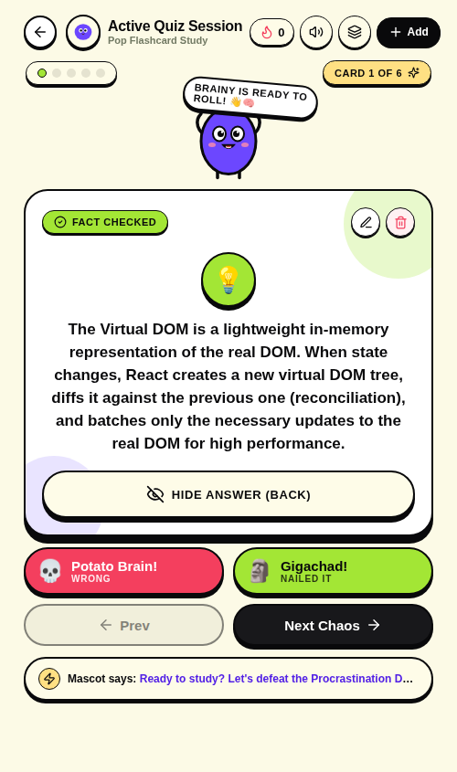
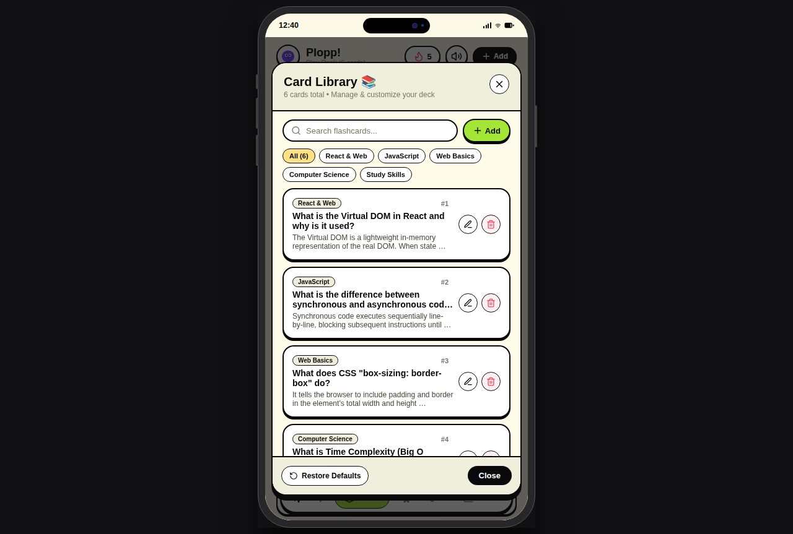
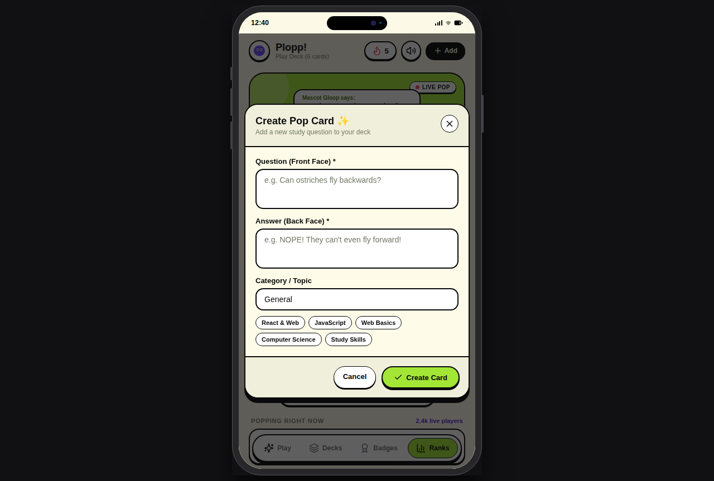
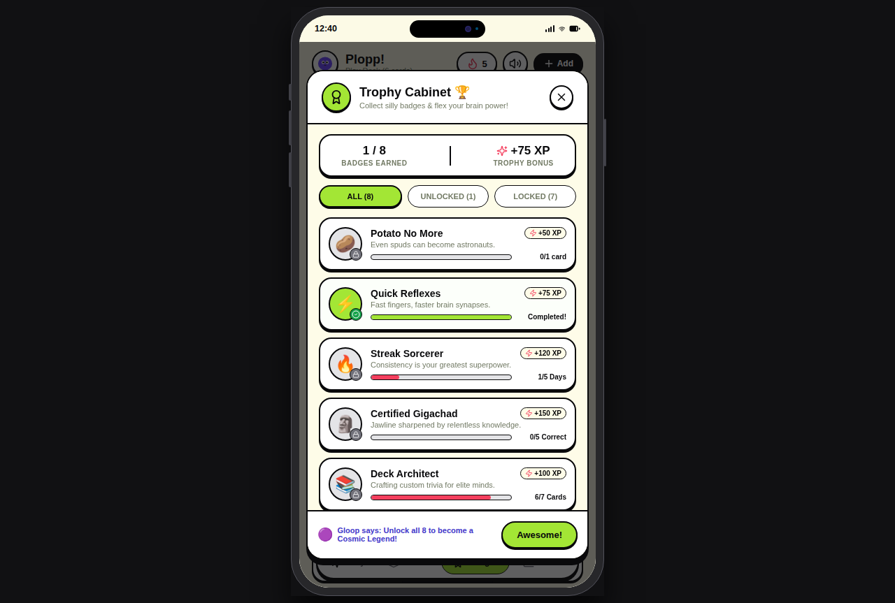

# 🃏 Pop Cartoon Flashcard Quiz App — CodeAlpha Internship (Task 1)

<div align="center">

[](https://www.codealpha.tech/)
[](https://reactnative.dev/)
[](https://expo.dev/)
[](https://www.typescriptlang.org/)
[](LICENSE)
[](https://expo.dev/)

**An interactive, gamified flashcard study application engineered with a Pop Cartoon Neo-brutalist design system, living mascot reactions, 3D tactile physics, 8-bit synthetic sound effects, and full offline CRUD management.**

[Features](#-features) • [CodeAlpha Matrix](#-codealpha-task-requirements) • [Screenshots](#-screenshots--ui-walkthrough) • [Tech Stack](#-tech-stack--architecture) • [Getting Started](#-getting-started) • [License](#-license)

</div>

---

## 📌 Project Overview
**Pop Cartoon Flashcard Quiz** was developed as part of the **CodeAlpha App Development Internship (Task 1: Flashcard Quiz App)**. 

Traditional flashcard applications often feel monotonous and dull. This project reimagines self-paced study with high-energy gamification, arcade-style spring physics, audio feedback, and an expressive SVG mascot named **Gloop** who laughs, celebrates, or cries along with your study progress!

---

## 🎯 CodeAlpha Task Requirements Matrix

Every single functional requirement outlined in the official CodeAlpha Internship Brief has been fully implemented, rigorously tested, and polished:

| Requirement from CodeAlpha Instruction | Implementation in Pop Cartoon Quiz | Status |
| :--- | :--- | :---: |
| **Question on front, Answer on back** | Tactile 3D Flashcard with front/back reveal and peek answer animation | ✅ 100% Implemented |
| **"Show Answer" button** | Dedicated `TAP TO PEEK ANSWER!` action and instant card flip reveal | ✅ 100% Implemented |
| **Navigate using "Next" and "Previous"** | Heavy tactile `PREV` and `NEXT CHAOS` buttons with boundary checks & wrap | ✅ 100% Implemented |
| **Add, Edit, and Delete flashcards** | Full CRUD modal suite with validation, prefilled forms, and safe deletion prompt | ✅ 100% Implemented |
| **Simple and clean user interface** | High-contrast Pop Cartoon Neo-brutalism (`#fcfae6` cream, `#09090b` border, `#a3e635` lime) | ✅ 100% Implemented |
| **Mobile-First Experience** | Responsive Smartphone Chassis for desktop preview with native edge-to-edge support | ✅ 100% Implemented |

---

## 🌟 Features

### 1. 🐣 Living Mascot — "Gloop"
- **Dynamic Mood Engine**: Gloop reacts in real-time based on your recall accuracy:
  - 🧐 *Thinking*: Pondering the front question with you.
  - 🌟 *Ecstatic*: Blushing and jumping for joy when you answer correctly ("Gigachad!").
  - 🥔 *Defeated*: Comically melting when you miss a question ("Potato Brain!").
  - 🏆 *Trophy*: Brandishing a sparkling golden cup upon completing a study round.
- **Witty Commentary**: Speech bubbles delivering playful encouragement and roasts.

### 2. 🖲️ Tactile 3D Spring Physics & 8-Bit SFX
- **Arcade Extrusions**: Solid dark drop shadows (`0 8px 0 #09090b`) with mechanical `translateY(4px)` press depth.
- **Web Audio API**: Real-time synthetic 8-bit sound effects (card flip, correct chime, wrong buzz, combo streak fanfares) without heavy audio asset downloads.

### 3. 🧠 Study Modes & Self-Assessment
- **Recall Grading**:
  - `🥔 Potato Brain! (WRONG)`: Flags card for further review, resets combo.
  - `⚡ Gigachad! (NAILED IT)`: Increases combo streak, awards XP, and fires particle confetti.
- **Bento-Box Round Summary**: End-of-deck summary screen displaying accuracy percentage, XP earned, and mastery badges.

### 4. 🗂️ Full Deck Management (CRUD)
- **Create**: Add new flashcards with customizable questions, answers, and tags.
- **Edit**: Edit existing cards with prefilled inputs and real-time state sync.
- **Delete**: Safe deletion prompt dialog prevents accidental data loss.
- **Search & Filter**: Real-time keyword filter across all cards in your deck.
- **Persistence**: Instant local caching using `@react-native-async-storage/async-storage`.

### 5. 🏆 Gamification: Badges & Leaderboard
- **Badges Trophy Cabinet**: Unlockable milestone achievements (First Step, Quick Thinker, Streak Master, Gigachad Legend).
- **Brain Tiers Leaderboard**: Tier-based progression from *Novice* to *Gigachad Genius*.

---

## 📱 Screenshots & UI Walkthrough

| 1. Dashboard (Instant Start) | 2. Quiz Arena & Gloop | 3. Answer Peek Reveal |
|:---:|:---:|:---:|
|  |  |  |

| 4. Deck Manager (CRUD & Search) | 5. Add / Edit Card Modal | 6. Badges & Leaderboard |
|:---:|:---:|:---:|
|  |  |  |

---

## 🛠️ Tech Stack & Architecture

- **Framework**: [React Native](https://reactnative.dev/) (0.76.7) with [Expo SDK](https://expo.dev/) (52.0)
- **Language**: [TypeScript](https://www.typescriptlang.org/) (Strict typing throughout)
- **State Management**: React Context API (`FlashcardContext`, `GamificationContext`)
- **Persistence**: `@react-native-async-storage/async-storage`
- **Audio Engine**: Web Audio API Synthetic Synthesizer
- **Styling**: StyleSheet API with Pop Cartoon Neo-brutalist theme tokens

```
CodeAlpha_FlashcardQuizApp/
├── App.tsx                        # Root component & Responsive Mobile Chassis
├── app.json                       # Expo application manifest
├── package.json                   # Project dependencies and scripts
├── tsconfig.json                  # TypeScript configuration
├── LICENSE                        # MIT License
├── src/
│   ├── components/                # Modular UI Components
│   │   ├── MobileDeviceFrame.tsx  # Realistic Smartphone frame for desktop preview
│   │   ├── AppModal.tsx           # Encapsulated frame-bounded modal container
│   │   ├── PopHeader.tsx          # Progress bar, streak flame counter, audio toggle
│   │   ├── MascotCharacter.tsx    # Animated SVG Living Mascot Gloop
│   │   ├── PopFlashcardViewer.tsx # 3D Neo-brutalist card with peek/flip mechanics
│   │   ├── PopQuizControls.tsx    # "Potato Brain", "Gigachad", Prev/Next buttons
│   │   ├── AddEditCardModal.tsx   # Add and Edit flashcard modal with validation
│   │   ├── DeleteConfirmModal.tsx # Safe deletion prompt
│   │   ├── CardListModal.tsx      # Deck browser with instant search
│   │   ├── BadgesModal.tsx        # Trophy cabinet with unlocked achievements
│   │   ├── RanksModal.tsx         # Brain Tiers and global leaderboard
│   │   └── ConfettiExplosion.tsx  # Particle victory celebration
│   ├── context/
│   │   ├── FlashcardContext.tsx   # Flashcard CRUD, navigation, and flip state
│   │   └── GamificationContext.tsx# Score, XP, combo streak, mascot reactions
│   ├── data/
│   │   └── seedFlashcards.ts      # Starter questions covering CS, Web & Mobile Dev
│   ├── services/
│   │   ├── soundFx.ts             # 8-bit synthetic Web Audio SFX
│   │   └── mascotReactions.ts     # Dynamic dialogue & reaction selector
│   └── theme/
│       └── flashcardTheme.ts      # Design tokens (colors, borders, shadows)
```

---

## 🚀 Getting Started

### Prerequisites
- [Node.js](https://nodejs.org/) (v18 or newer)
- npm or yarn

### Installation & Setup

1. **Clone the repository:**
   ```bash
   git clone https://github.com/YOUR_USERNAME/CodeAlpha_FlashcardQuizApp.git
   cd CodeAlpha_FlashcardQuizApp
   ```

2. **Install dependencies:**
   ```bash
   npm install
   ```

3. **Start the development server:**
   ```bash
   # Launch on Web:
   npm run web

   # Or launch on Android / iOS:
   npm run android
   npm run ios
   ```

4. **Open in browser:**
   Navigate to `http://localhost:8082` (or the port displayed in your terminal).

---

## 👨‍💻 Author

**Md. Ismail Hossen**
- **Internship**: App Development Intern at **CodeAlpha** (Student ID: `CA/DF1/298576`)
- **LinkedIn**: [Connect on LinkedIn](https://www.linkedin.com)
- **GitHub**: [github.com](https://github.com)

---

## 📄 License

This project is licensed under the MIT License — see the [LICENSE](LICENSE) file for details.
